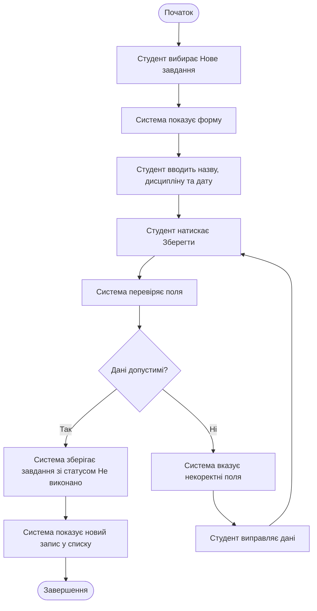

# Activity-діаграма Student Task Manager

**Автор:** Руслан Махмадов  
**Група:** 31 КНС  
**Практична робота №11:** Activity-діаграма ключового процесу

## Загальна інформація

**Продукт:** Student Task Manager.  
**Процес:** створити навчальне завдання.  
**Основний актор:** студент.  
**Пов’язаний use case:** [UC-01 Створити завдання](use-case.md#uc-01-створити-завдання).  
**Пов’язана user story:** [US-01 Створення навчального завдання](user-stories.md#us-01-створення-навчального-завдання).  
**Функціональна вимога:** FR-01, показ результату — FR-02.  
**Умови якості:** NFR-01 і NFR-02 у [requirements.md](requirements.md).  
**Мета:** зберегти одне навчальне завдання із назвою, дисципліною та строком здачі й показати його у списку.

## Межі процесу

Передумова — застосунок відкрито на екрані списку завдань. Список може бути порожнім. Процес починається, коли студент вибирає «Нове завдання», і успішно завершується після відображення збереженого запису. При некоректному введенні студент отримує пояснення та повертається до виправлення полів.

## Основні дії

1. Студент вибирає «Нове завдання».
2. Система показує форму.
3. Студент вводить назву, дисципліну та дату здачі.
4. Студент натискає «Зберегти».
5. Система перевіряє введені поля.
6. За допустимих значень система зберігає один запис зі статусом «Не виконано».
7. Система відображає нове завдання у списку.
8. За некоректних значень система вказує помилкові поля.
9. Студент виправляє дані та повторює спробу збереження.

## Activity-діаграма

## Пояснення діаграми

Студент починає створення завдання, заповнює форму та підтверджує збереження. Система перевіряє назву, дисципліну й дату. Гілка «Так» веде до збереження одного завдання зі статусом «Не виконано» та показу результату. Гілка «Ні» веде до повідомлення про некоректні поля й виправлення даних. Після виправлення студент знову натискає «Зберегти», а система повторює перевірку.

## Умова та результати

Назва й дисципліна мають бути непорожніми після видалення крайніх пробілів. Дата повинна бути наявною календарною датою у форматі YYYY-MM-DD. Наприклад, 2026-11-20 допустима, а 2026-02-30 — недопустима.

Поки хоча б одне поле некоректне, сховище залишається без змін. Успішне завершення означає, що створено рівно один новий запис, який містить указані поля та відображається у списку. За NFR-01 він має зберегтися після штатного повторного запуску на тому самому пристрої.

## Перевірка узгодженості

| Елемент процесу | Попередній матеріал | Відповідність |
| --- | --- | --- |
| Актор і запуск дії «Нове завдання» | UC-01, US-01 | Збігаються зі сценарієм ПР10 |
| Назва, дисципліна та дата | FR-01 | Усі обов’язкові дані присутні |
| Перевірка полів і повідомлення | NFR-02 та відхилення UC-01 | Є негативна гілка з поверненням |
| Збереження одного запису та початковий статус | FR-01, US-01 | Показано на гілці «Так» |
| Показ у списку | FR-02 і післяумова UC-01 | Є перед завершенням |

Діаграма містить один початок, дев’ять дій, одну умову з підписаними гілками «Так» і «Ні» та одне успішне завершення. Повернення з виправлення веде до повторного підтвердження й перевірки, тому помилкові дані не потрапляють безпосередньо до збереження.

## Висновок

Для ключового процесу створення навчального завдання побудовано activity-діаграму Mermaid. Визначено дії студента та реакції системи, перевірку полів, успішний шлях і повернення до виправлення при помилці. Процес узгоджено з UC-01, US-01 і вимогами FR-01, FR-02, NFR-01 та NFR-02.
