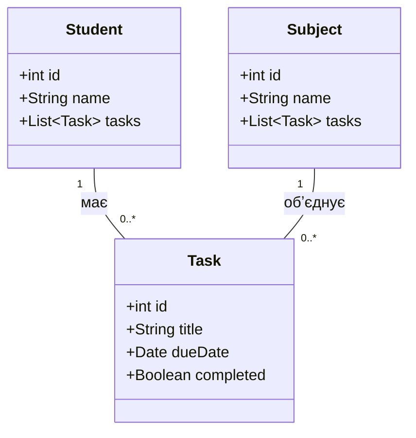

# Спрощена class-діаграма Student Task Manager

**Автор:** Руслан Махмадов  
**Група:** 31 КНС  
**Практична робота №12:** Основні сутності та їхні зв’язки

## Межі моделі

Модель описує дані чотирьох функцій MVP: створення завдання, перегляд списку, редагування та позначення виконання. Джерела — [вимоги](requirements.md), [user stories](user-stories.md), [use-case модель](use-case.md) та [activity-діаграма](activity-diagram.md).

Виділено три сутності: Student, Task і Subject. Студент є власником списку завдань, завдання належить дисципліні. Student представляє локального власника даних. Для цієї моделі прийнято локальний профіль з ідентифікатором та ім’ям; правила реєстрації чи входу до складу поточного MVP не додано.

## Класи та властивості

### Student — студент

Представляє власника навчальних завдань.

| Властивість | Тип | Призначення |
| --- | --- | --- |
| id | int | Унікальний додатний ідентифікатор студента |
| name | String | Ім’я студента для локального профілю |
| tasks | List~Task~ | Колекція завдань студента, яка може бути порожньою |

### Task — навчальне завдання

Представляє роботу з назвою, строком здачі та станом виконання.

| Властивість | Тип | Призначення |
| --- | --- | --- |
| id | int | Унікальний додатний ідентифікатор завдання |
| title | String | Непорожня назва після видалення крайніх пробілів |
| dueDate | Date | Календарна дата здачі, відображувана у форматі YYYY-MM-DD |
| completed | Boolean | false для «Не виконано», true для «Виконано» |

Дисципліну завдання представлено асоціацією із Subject. Власника визначає асоціація зі Student.

### Subject — дисципліна

Представляє навчальну дисципліну, назва якої вказується у завданні.

| Властивість | Тип | Призначення |
| --- | --- | --- |
| id | int | Унікальний додатний ідентифікатор дисципліни |
| name | String | Непорожня назва дисципліни |
| tasks | List~Task~ | Колекція завдань цієї дисципліни, яка може бути порожньою |

Колекції tasks і лінії зв’язків на діаграмі описують ті самі асоціації. Це дві форми показу належності завдань, а не два незалежні набори даних.

## Mermaid-діаграма

## Зв’язки та кратність

- Один Student може мати від нуля до багатьох Task. Кожне Task належить рівно одному Student.
- Один Subject може об’єднувати від нуля до багатьох Task. Кожне Task пов’язане рівно з одним Subject, оскільки дисципліна обов’язкова у FR-01.
- Позначення «1» означає рівно один об’єкт, «0..*» — порожню колекцію або довільну кількість об’єктів.
- Для зв’язків використано звичайні асоціації. Модель не задає каскадного видалення завдань при видаленні власника чи дисципліни.

## Пояснення проєктних рішень

Student потрібен для представлення актора й належності особистих даних. Subject має власну назву та пов’язаний із багатьма завданнями, тому дисципліна представлена окремою сутністю. Task є центральним об’єктом усіх функцій MVP.

Назва й дата залишаються властивостями Task. Два стани виконання подано Boolean, що узгоджено з переходом «Не виконано» → «Виконано» у FR-04. Форми, кнопки та повідомлення є елементами інтерфейсу, тому окремими класами предметної області їх не створено.

## Відповідність вимогам та сценаріям

| Функція | Дані та зв’язки моделі | Вимога і сценарій |
| --- | --- | --- |
| Створення | Нове Task з title, dueDate та completed=false; зв’язки зі Student і Subject | FR-01, US-01, UC-01 |
| Перегляд | Student.tasks, Task.title, Subject.name, Task.dueDate та Task.completed | FR-02, US-02, UC-02 |
| Редагування | Зміна title, dueDate або зв’язку із Subject у вибраному Task | FR-03, US-03, UC-03 |
| Виконання | Зміна completed з false на true | FR-04, US-04, UC-04 |
| Перевірка введення | Перевірка title, Subject.name і dueDate перед збереженням Task | NFR-02, activity-діаграма |
| Повторний запуск | Збереження значень та належності Task | NFR-01 |

На кроці збереження в activity-діаграмі створюється саме Task. Назва, дисципліна й дата з форми відображені в моделі, а completed задає початковий і завершений стани завдання. Вибір конкретного способу зберігання даних залишається наступним етапом реалізації.

## Висновок

Визначено три основні класи Student Task Manager: Student, Task і Subject. Кожен клас має від трьох до чотирьох властивостей із типами даних. Установлено два зв’язки один-до-багатьох з урахуванням порожнього списку завдань. Модель узгоджено з MVP, вимогами, user stories, use-case моделлю та activity-діаграмою.
