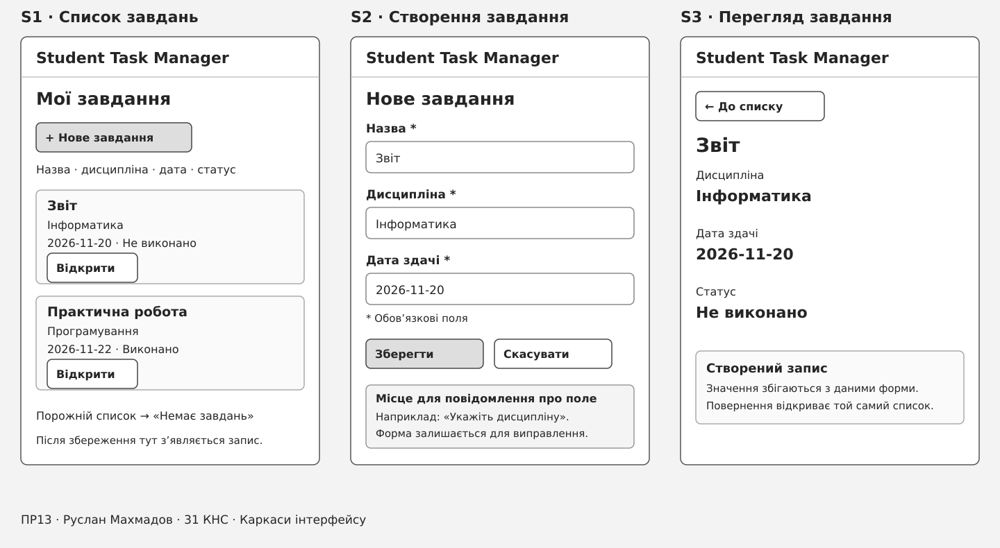
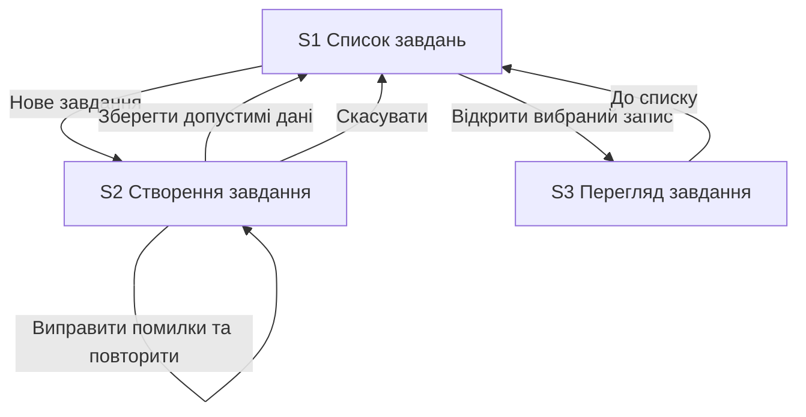

# Ескізи основних екранів Student Task Manager

**Автор:** Руслан Махмадов  
**Група:** 31 КНС  
**Практична робота №13:** Ескізи інтерфейсу

## Основний сценарій

Студент створює навчальне завдання та переглядає збережені дані. В основі — [UC-01](use-case.md#uc-01-створити-завдання), [US-01](user-stories.md#us-01-створення-навчального-завдання) та [activity-діаграма](activity-diagram.md). Після успішного збереження студент спочатку повертається до списку, як у сценарії ПР10, а потім може відкрити створений запис.

## Перелік екранів

1. S1 — список завдань.
2. S2 — створення завдання.
3. S3 — перегляд вибраного завдання.

## Ескізи

На спільному аркуші розташовано три окремі екрани. Використано монохромний каркас із підписами полів і кнопок. Ескізи створено у векторному форматі SVG, який зберігає текст та елементи для подальшого редагування.

[Відкрити SVG-аркуш окремо](images/screen-sketches.svg)

## Екран S1 Список завдань

**Призначення:** показати збережені роботи й почати створення нової.  
**Інформація:** назва, дисципліна, дата здачі та поточний статус кожного запису.  
**Елементи керування:** головна кнопка «Нове завдання» та кнопка «Відкрити» біля кожного запису.  
**Основна дія:** перейти до створення завдання на S2.  
**Інший перехід:** «Відкрити» показує дані вибраного запису на S3.

Для порожнього списку передбачено повідомлення «Немає завдань». Запис «Звіт» на ескізі показує стан списку після успішного створення.

## Екран S2 Створення завдання

**Призначення:** отримати дані нової роботи.  
**Інформація й поля:** обов’язкові назва, дисципліна та дата здачі.  
**Елементи керування:** «Зберегти» та «Скасувати».  
**Основна дія:** зберегти допустимі дані й перейти до S1 із новим записом.  
**Повернення:** «Скасувати» веде до S1 без створення запису.

Нижня область призначена для пояснення помилки з назвою некоректного поля. За помилки перевірки користувач залишається на S2, виправляє дані та знову натискає «Зберегти». Показаний приклад повідомлення є позначенням області альтернативного стану. Статус нового запису задається автоматично як «Не виконано».

## Екран S3 Перегляд завдання

**Призначення:** показати дані конкретної збереженої роботи.  
**Інформація:** назва, дисципліна, дата здачі й статус.  
**Елемент керування:** «До списку».  
**Основна дія:** звірити збережені дані й повернутися на S1.

Це подання наявних полів запису в межах FR-02, а не додаткова функція предметної області.

## Схема переходів

| Поточний екран | Дія | Наступний стан |
| --- | --- | --- |
| S1 | «Нове завдання» | S2 з порожніми полями |
| S2 | «Зберегти», якщо дані допустимі | S1 з рівно одним новим записом |
| S2 | «Зберегти», якщо дані некоректні | S2 з поясненням помилки |
| S2 | «Скасувати» | S1 без нового запису |
| S1 | «Відкрити» | S3 з даними вибраного запису |
| S3 | «До списку» | S1 |

## Відповідність попереднім матеріалам

| Вимога або сценарій | Елемент ескізу | Екран |
| --- | --- | --- |
| FR-01, US-01, UC-01 | «Нове завдання», три поля та «Зберегти» | S1, S2 |
| FR-02, US-02 | Список із назвою, дисципліною, датою й статусом; подання вибраного запису | S1, S3 |
| NFR-02 та негативна гілка activity-діаграми | Область пояснення некоректних полів, повторне збереження | S2 |
| Післяумова UC-01 | Запис «Звіт» зі статусом «Не виконано» після збереження | S1 |
| Дані Task та зв’язок із Subject | Назва, дисципліна, дата, статус | Усі три екрани |

Ескізи охоплюють один обраний сценарій MVP. Редагування й позначення виконання залишаються у вимогах продукту та можуть бути предметом окремих екранів у наступних роботах.

## Перевірка сценарію

Послідовність демонстрації — S1 → «Нове завдання» → S2 → введення «Звіт», «Інформатика», 2026-11-20 → «Зберегти» → S1 → «Відкрити» біля нового запису → S3 → «До списку» → S1. Скасування й повернення мають визначені переходи. Усі поля та кнопки підписано.

## Висновок

Створено три ескізи основних екранів Student Task Manager і схему переходів між ними. На екранах показано поля, збережені дані, головні дії та повернення. Основний сценарій узгоджено з UC-01, вимогами й activity-діаграмою попередніх робіт.
