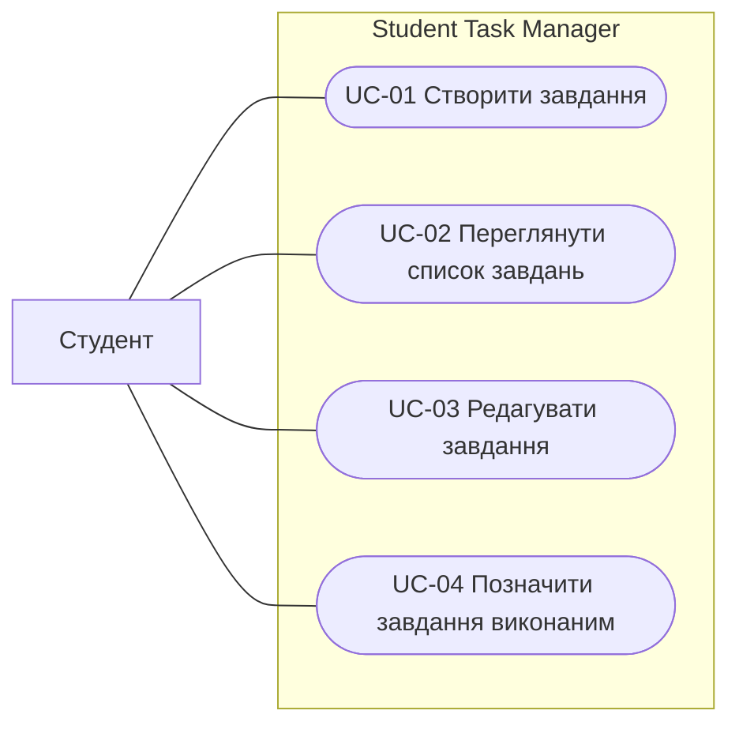

# Use-case модель Student Task Manager

**Автор:** Руслан Махмадов  
**Група:** 31 КНС  
**Практична робота №10:** Use-case діаграма та основний сценарій

## Загальна інформація

**Назва продукту:** Student Task Manager.  
**Основний актор:** студент.  
**Додаткові актори:** відсутні.

Модель описує чотири основні можливості поточного MVP. Її узгоджено з [вимогами](requirements.md), [user stories](user-stories.md) та [описом продукту](product-description.md).

## Опис актора та межі системи

Студент — користувач, який організовує власні навчальні роботи за дисциплінами, строками та станом виконання. Його мета — бачити актуальний список робіт і контролювати їх завершення.

Актор розташований поза межею системи. Усередині межі Student Task Manager розміщено створення, перегляд, редагування та позначення виконання завдань. Усі чотири випадки використання доступні студенту.

## Основні випадки використання

| Код | Випадок використання | Мета студента | User story | Вимога | MVP |
| --- | --- | --- | --- | --- | --- |
| UC-01 | Створити завдання | Зафіксувати отриману роботу та строк здачі | US-01 | FR-01 | Так |
| UC-02 | Переглянути список завдань | Визначити, які роботи ще потрібно виконати | US-02 | FR-02 | Так |
| UC-03 | Редагувати завдання | Актуалізувати дані після уточнення умов роботи | US-03 | FR-03 | Так |
| UC-04 | Позначити завдання виконаним | Відрізнити завершені роботи від незавершених | US-04 | FR-04 | Так |

## Діаграма

Навчальну use-case модель подано через Mermaid flowchart. Прямокутна область позначає межу системи, овальні вузли — випадки використання. Лінії від актора показують доступні можливості й не задають порядок дій.

## Основний сценарій

### UC-01 Створити завдання

**Мета:** додати навчальну роботу до особистого списку із дисципліною та датою здачі.  
**Основний актор:** студент.  
**Передумова:** застосунок відкрито на екрані списку завдань; студент має назву роботи, дисципліну та строк здачі. Список може бути порожнім.  
**Тригер:** студент вибирає дію «Нове завдання».

### Послідовність дій

1. Система відкриває форму з полями назви, дисципліни та дати здачі.
2. Студент вводить назву «Звіт».
3. Студент указує дисципліну «Інформатика».
4. Студент указує дату здачі 2026-11-20.
5. Студент натискає «Зберегти».
6. Система перевіряє, що назва й дисципліна непорожні після видалення крайніх пробілів, а дата є наявною календарною датою у форматі YYYY-MM-DD.
7. Система зберігає одне нове завдання з указаними значеннями та початковим статусом «Не виконано».
8. Система показує створений запис у списку з назвою, дисципліною, датою здачі й статусом.

**Післяумова:** рівно одне нове завдання збережене та видиме у списку. Попередні записи збережені. Після штатного повторного запуску на тому самому пристрої нове завдання залишається доступним.

### Відхилення при некоректних даних

Якщо на кроці 6 виявлено порожню або пробільну назву чи дисципліну або недопустиму дату, система вказує некоректне поле, а сховище залишається без змін. Студент може виправити введення та повторити збереження.

## Перевірка узгодженості

- Актор «Студент» збігається з актором усіх чотирьох user stories.
- Кожен UC відповідає одній функції MVP, одній user story та одній функціональній вимозі.
- Основний сценарій UC-01 відповідає US-01 і FR-01. Показ запису узгоджено з FR-02, перевірку даних — із NFR-02, збереження після повторного запуску — із NFR-01.
- У діаграмі чотири випадки використання всередині межі продукту. Актор розташований зовні та має зв’язок із кожним випадком.
- FR-05 «Сортування за строком здачі» належить до наступних версій і не входить до цієї моделі MVP.

## Висновок

Визначено одного актора та чотири випадки використання Student Task Manager. Створено Mermaid-діаграму з межею системи й асоціаціями актора з кожною функцією. Для UC-01 описано мету, передумову, тригер, вісім послідовних кроків і післяумову. Модель узгоджено з вимогами FR-01–FR-04 та user stories US-01–US-04.
